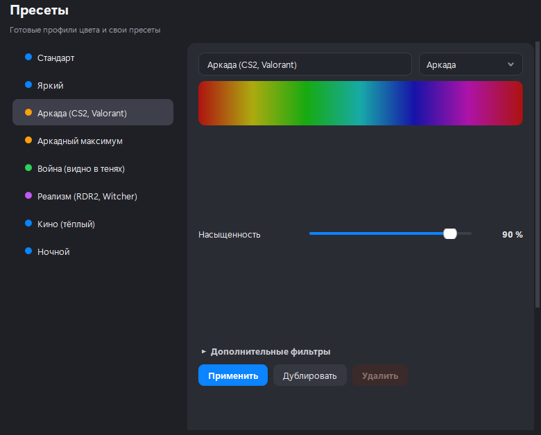
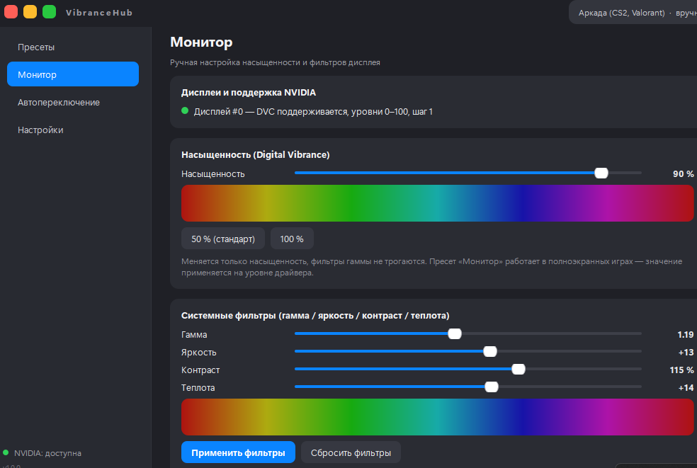
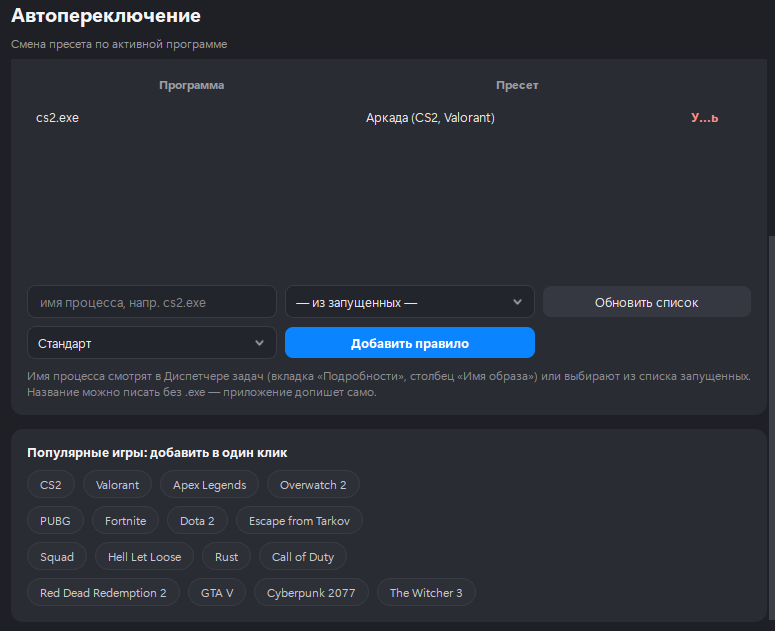

# VibranceHub

Замена вкладки **NVIDIA Control Panel -> «Регулировка цветовых параметров рабочего
стола»**: насыщенность (Digital Vibrance), игровые фильтры, заготовленные пресеты,
автопереключение по игре, хоткеи и трей. Нужна тем, у кого на Windows 11 сама
NVIDIA Control Panel не открывается, а насыщенность хочется крутить.
## Скриншоты





Интерфейс — в стиле macOS: тёмное окно, боковая панель, «светофор», свитчи.

## Возможности

- **Насыщенность 0–100 %** через NVAPI (тот же механизм, что у NVIDIA Control Panel
  и vibranceGUI). Работает мгновенно и в полноэкранных играх.
- **Заготовленные пресеты** (можно менять, дублировать, удалять, создавать свои):
  - *Аркада* (CS2, Valorant, Apex...) — насыщенность 90–100 %, чуть больше контраста;
  - *Война* (Tarkov, Squad, HLL, CoD) — приглушённый цвет, светлее тени,
    чуть ниже контраст — врагов видно в тёмноте;
  - *Реализм* (RDR2, Witcher, GTA V) — живая, но не кислотная картинка;
  - *Рабочий стол* — стандарт, яркий, тёплый «кино», ночной.
- **Системные фильтры**: гамма / яркость / контраст / теплота (через гамму Windows,
  работает на любой видеокарте).
- **Автопереключение**: раз в секунду смотрит активное окно; запустил игру —
  включился пресет игры, свернул — пресет рабочего стола. Правила добавляются
  вручную или в один клик из списка популярных игр.
- **Глобальные хоткеи**: `Ctrl+Alt+1..8` — пресеты по слотам, `Ctrl+Alt+0` — рабочий стол.
- **Трей**: меню пресетов, уведомления, пауза автопереключения.
- **Автозапуск с Windows**, старт свёрнутым, восстановление исходных значений при выходе.

## Установка и запуск

1. Нужен **Python 3.10+ (64-битный!)** — `python.org`.
2. Распакуй папку, зайди в неё и запусти `run.bat` — он поставит зависимости
   и запустит приложение. Либо вручную:

   ```
   pip install -r requirements.txt
   python main.py
   ```

3. Сборка в один exe: `build_exe.bat` → результат в `dist\VibranceHub.exe`.
   Если SmartScreen предупреждает — «Подробнее» → «Выполнить в любом случае»
   (это обычное поведение для сборок PyInstaller без подписи).

Запуск сразу в трей: `pythonw main.py --minimized`.

## Если bat-файл выдаёт ошибки или окно закрывается мгновенно

В ранних версиях `run.bat` и `build_exe.bat` был русский текст — cmd.exe из-за
кодировки «ломал» команды на куски (ошибки вида `'yInstaller' is not recognized`).
В актуальной версии батники написаны на английском и проверяют ошибки сами:
окно больше не закрывается молча, при сбое там будет `[ERROR]` и пауза.

Запуск вручную через cmd (если хочешь без батников):

```
cd /d C:\путь\к\VibranceHub
python -m pip install -r requirements.txt
python main.py
```

Сборка exe вручную:

```
python -m pip install pyinstaller
python -m PyInstaller --noconfirm --onefile --windowed --name VibranceHub --icon assets\icon.ico --add-data "assets;assets" main.py
```

Если окно приложения не появляется — запусти `run_debug.bat`: он оставит консоль
открытой и покажет текст ошибки. После сборки exe первый запуск медленный
(10–20 секунд) — PyInstaller распаковывает файлы во временную папку, это норма.

## Автопереключение: как найти имя процесса

Диспетчер задач → вкладка **«Подробности»** → столбец **«Имя образа»**
(например `cs2.exe`). Или на странице «Автопереключение» нажми «Обновить список»
и выбери процесс из запущенных. Расширение `.exe` можно не дописывать.

### Когда срабатывает возврат к пресету рабочего стола

- Пресет рабочего стола включается **только после выхода из игры, добавленной
  в правила** автопереключения. Если ты выбрал пресет вручную (или через хоткей/
  трей) и перешёл в другое окно — выбор не перебивается.
- Драйвер NVIDIA сам сбрасывает насыщенность при смене видеорежима (запуск/выход
  из полноэкранной игры) — поэтому VibranceHub раз в 5 секунд сверяет фактический
  уровень с выбранным и молча возвращает его, если драйвер сбросил.

## Про гамму-фильтры

Windows по умолчанию ограничивает силу гаммы (известное ограничение `SetDeviceGammaRamp`).
Если фильтры применяются слабо — Настройки → «Разблокировать полный диапазон гаммы»
(нужны права администратора, меняется ключ `GdiIcmGammaRange`; кнопка «Вернуть как было» откатывает).

## Важные замечания

- Насыщенность работает **только с NVIDIA** (это функции драйвера). Фильтры
  гаммы/яркости/контраста работают на любой видеокарте.
- Выключи **HDR** в Windows — в режиме HDR и насыщенность, и гамма визуально не применяются.
- Крестик окна не закрывает приложение (как в macOS), а сворачивает в трей.
  Полный выход — значок в трее → «Выход (вернуть настройки)».
- Если NVAPI недоступна (драйвер без DVC и т.п.) — приложение запустится в демо-режиме
  и предупредит на странице «Монитор».

## Структура проекта

```
VibranceHub/
├── main.py                  # точка входа
├── requirements.txt
├── run.bat                  # установка зависимостей + запуск
├── build_exe.bat            # сборка exe через PyInstaller
├── assets/                  # иконки
└── app/
    ├── core/
    │   ├── nvapi.py         # Digital Vibrance через nvapi64.dll (метод vibranceGUI)
    │   ├── gamma.py         # гамма/яркость/контраст через SetDeviceGammaRamp
    │   ├── watcher.py       # слежение за активным окном
    │   ├── procinfo.py      # имена процессов (активное окно, список запущенных)
    │   ├── hotkeys.py       # глобальные хоткеи (RegisterHotKey)
    │   ├── sysops.py        # автозапуск, разблокировка гаммы
    │   ├── applier.py       # применение пресетов к дисплею
    │   └── config.py        # конфиг, модель пресетов (%APPDATA%/VibranceHub)
    ├── tray.py              # значок в трее
    └── ui/
        ├── theme.py         # macOS-тема (QSS)
        ├── widgets.py       # свитч, слайдеры, карточки, превью
        ├── main_window.py
        └── pages/           # Пресеты, Монитор, Автопереключение, Настройки
```

Конфиг и пресеты хранятся в `%APPDATA%\VibranceHub\config.json`.
